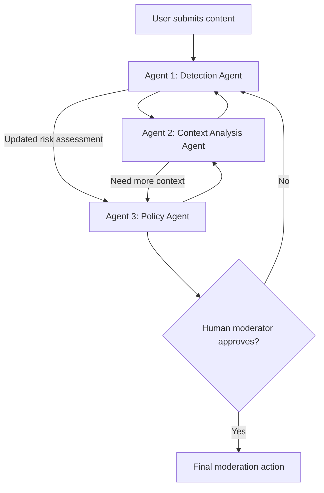

- Do not hardcode outputs.
- Implement three agents:
  DetectionAgent
  ContextAnalysisAgent
  PolicyAgent
- Agents must collaborate with at least one feedback loop:
  DetectionAgent detects possible harmful content, gives initial confidence score
  ContextAnalysisAgent checks conversation history, sarcasm, previous messages, user relationships, cultural/context clues then sends feedback back to DetectionAgent 
  PolicyAgent decides allow, warn, remove, suspend. But sometimes it may need more context again. Then it asks Agent 2 again.
- Human reviews final recommendation, approves or rejects. if rejected, workflow loops back again 
- Save JSONL trace logs to logs/agent_trace.jsonl.
- Also print important trace events to stdout.
- Include retry handling and clear error responses.
- Include SAMPLE_MODE=true support using sample input data only, not hardcoded final outputs.
- Include metadata.json using use_case_id "12" as an example.
- Include three input examples and three output examples.

Generate minimal, readable, production-ready code. Avoid unnecessary frameworks.

diagram

